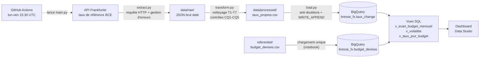

# Bresse Mécanique – Suivi automatisé du risque de change

Pipeline de données **API → Python → BigQuery → Data Studio** qui collecte chaque jour ouvré les taux de change officiels de la Banque centrale européenne (BCE), les compare au budget de l'entreprise et mesure leur impact en euros sur le résultat.

> **Dashboard Data Studio (lecture seule) :** `https://datastudio.google.com/reporting/fbead226-4c40-45ca-bb59-aaab2c293be3`

---

## Sommaire

1. [Cas d'usage](#1-cas-dusage)
2. [Architecture du pipeline](#2-architecture-du-pipeline)
3. [Structure du dépôt](#3-structure-du-dépôt)
4. [Description des données](#4-description-des-données)
5. [Préparation et contrôles qualité](#5-préparation-et-contrôles-qualité)
6. [Stockage dans BigQuery](#6-stockage-dans-bigquery)
7. [Requêtes SQL](#7-requêtes-sql)
8. [Dictionnaire des colonnes calculées](#8-dictionnaire-des-colonnes-calculées)
9. [Automatisation](#9-automatisation)
10. [Installation et exécution](#10-installation-et-exécution)
11. [Dashboard](#11-dashboard)
12. [Preuves d'exécution](#12-preuves-dexécution)
13. [Sécurité](#13-sécurité)
14. [Limites](#14-limites)
15. [Pistes d'amélioration](#15-pistes-damélioration)

---

## 1. Cas d'usage

**Entreprise (fictive) :** Bresse Mécanique, PME industrielle de l'Ain (sous-traitance mécanique).

**Problème :** une partie des achats et des ventes est facturée en devises étrangères, mais le budget et les comptes sont en euros. Chaque variation de taux de change modifie donc le coût réel des achats et la valeur réelle des ventes par rapport au budget.

| Devise | Sens | Flux | Montant mensuel | Part des flux (2026) |
|---|---|---|---|---|
| USD | Achat | Aluminium et acier | 400 000 $ | 45 % |
| CNY | Achat | Composants électroniques | 1 500 000 ¥ | 24 % |
| GBP | Vente | Client britannique | 150 000 £ | 22 % |
| CHF | Achat | Outillage | 60 000 CHF | 9 % |

**Besoin du contrôle de gestion :** savoir chaque jour, sans ressaisie manuelle :
- si le taux du marché est au-dessus ou en dessous du taux budget ;
- combien l'écart de change a fait gagner ou perdre en euros, mois par mois ;
- quelle devise présente le plus de risque, pour décider où concentrer la couverture.

---

## 2. Architecture du pipeline



| Étape | Outil | Rôle |
|---|---|---|
| Extraction | Python (`requests`) | Appel de l'API, contrôle des erreurs, sauvegarde de la réponse brute |
| Transformation | Python (`pandas`) | Nettoyage, typage, dédoublonnage, contrôles qualité |
| Chargement | Python (`google-cloud-bigquery`) | Ajout des seules lignes nouvelles dans BigQuery |
| Calcul | SQL BigQuery | Agrégations, jointure avec le budget, volatilité, vues |
| Restitution | Data Studio | KPI, graphiques, filtre par devise |
| Orchestration | GitHub Actions | Exécution planifiée, conservation des logs |

`main.py` enchaîne les trois scripts. Si une étape échoue, les suivantes ne sont pas lancées et le script renvoie le code 1 : GitHub Actions marque alors l'exécution en échec.

---

## 3. Structure du dépôt

```
.
├── .github/workflows/pipeline.yml   # automatisation GitHub Actions
├── notebooks/exploration_api.ipynb  # exploration de l'API, nettoyage pas à pas, premier chargement
├── referentiel/budget_devises.csv   # taux budget et montants mensuels par devise
├── sql/
│   ├── 01_filtre_tri_usd.sql
│   ├── 02_moyenne_mensuelle.sql
│   ├── 03_jointure_ecart_budget.sql
│   ├── 04_volatilite.sql
│   ├── 05_taux_jour_vs_budget.sql
│   └── 06_vues_dashboard.sql
├── src/
│   ├── extract.py                   # étape 1 : extraction
│   ├── transform.py                 # étape 2 : préparation
│   ├── load.py                      # étape 3 : chargement BigQuery
│   └── main.py                      # enchaînement des 3 étapes
├── docs/                            # preuves d'exécution, export PDF du dashboard
├── requirements.txt
├── .gitignore
└── README.md
```

Non versionnés (voir `.gitignore`) : la clé du compte de service, `data/`, `logs/` et les environnements virtuels.

**Notebook et scripts.** Le notebook documente la démarche pas à pas : découverte de l'API, tests d'erreurs, nettoyage commenté, premier chargement dans BigQuery, chargement du budget. Les scripts de `src/` reprennent la même logique, sous une forme automatisable. Un rapprochement a été fait entre les deux : même nombre de lignes et taux identiques.

---

## 4. Description des données

### 4.1 Source : API Frankfurter (taux de référence BCE)

| Élément | Valeur |
|---|---|
| Fournisseur | [Frankfurter](https://frankfurter.dev), API gratuite, sans clé ni limite de volume |
| Route utilisée | `https://api.frankfurter.dev/v2/providers/ecb/rates` |
| Paramètres | `from=2025-01-01`, `quotes=USD,CNY,CHF,GBP` |
| Donnée | Taux de change de référence de la BCE : **nombre d'unités de devise pour 1 €** |
| Fréquence | Un taux par jour ouvré, publié vers 16 h (heure de Francfort). Pas de taux le week-end ni les jours fériés BCE |
| Format | JSON, une ligne par date et par devise |

**Pourquoi la BCE :** l'entreprise est en zone euro. Les taux BCE sont exprimés directement en euro, ils sont officiels et couvrent les 4 devises avec une seule base.

**Lecture d'un taux :** `USD = 1,17` signifie que 1 € s'échange contre 1,17 $. Quand le taux monte, l'euro s'apprécie : les achats en devise coûtent moins d'euros.

**Exemple de réponse brute :**
```json
{"date": "2026-10-15", "base": "EUR", "quote": "USD", "rate": 1.1342}
```

### 4.2 Table `bresse_fx.taux_change` (alimentée par le pipeline)

| Colonne | Type | Obligatoire | Description |
|---|---|---|---|
| `date_taux` | DATE | oui | Date de publication du taux par la BCE |
| `devise_base` | STRING | oui | Devise de départ, toujours EUR |
| `devise` | STRING | oui | Devise d'arrivée : USD, CNY, CHF ou GBP |
| `taux` | FLOAT64 | oui | Unités de devise pour 1 € |
| `source` | STRING | non | « BCE via API Frankfurter » |
| `date_collecte` | TIMESTAMP | non | Date et heure (UTC) de la collecte |

**Clé unique :** (`date_taux`, `devise`).
**Volume :** 1 816 lignes au premier chargement (12/10/2026), puis 4 lignes de plus par jour ouvré.

### 4.3 Table `bresse_fx.budget_devises` (référentiel métier)

Construite à partir de `referentiel/budget_devises.csv` et chargée une fois depuis le notebook (section 9, mode `WRITE_TRUNCATE`).

| Colonne | Type | Description |
|---|---|---|
| `devise` | STRING | Devise du flux |
| `annee` | INT64 | Année budgétaire (2025 ou 2026) |
| `sens` | STRING | `achat` ou `vente` |
| `categorie` | STRING | Nature du flux (ex. « Aluminium et acier ») |
| `taux_budget` | FLOAT64 | Taux de change retenu au budget (devises pour 1 €) |
| `montant_mensuel_devise` | INT64 | Montant mensuel du flux, en devise |

**Méthode de calcul des taux budget :**

| Budget | Référence | USD | CNY | CHF | GBP |
|---|---|---|---|---|---|
| 2025 | Moyenne BCE de **janvier 2025** | 1,04 | 7,56 | 0,94 | 0,84 |
| 2026 | Moyenne BCE de **décembre 2025** | 1,17 | 8,25 | 0,93 | 0,88 |

Le budget 2026 suit la pratique habituelle : il est figé sur les derniers cours connus avant le début de l'année. Pour 2025, aucune donnée de 2024 n'a été extraite, donc janvier 2025 sert d'approximation (voir [Limites](#14-limites)).

---

## 5. Préparation et contrôles qualité

### 5.1 Transformations (`src/transform.py`)

| Code | Transformation | Justification |
|---|---|---|
| T1 | Renommage : `date` → `date_taux`, `base` → `devise_base`, `quote` → `devise`, `rate` → `taux` | Noms explicites, en français |
| T2 | Typage : date, nombre décimal, texte en majuscules (`errors="coerce"`) | Une valeur illisible devient vide au lieu d'arrêter le script |
| T3 | Filtre sur les 4 devises du périmètre | Exclut toute devise non demandée |
| T5 | Suppression des lignes sans date ou sans taux | Une ligne incomplète n'est pas exploitable |
| T4 | Suppression des dates antérieures au 01/01/2025 | L'API renvoie aussi le dernier taux connu avant la date demandée (31/12/2024) |
| T6 | Une seule ligne par couple (`date_taux`, `devise`) | Garantit l'unicité de la clé |
| T7 | Ajout de `source` et `date_collecte` | Traçabilité |

Résultat au premier lancement : 4 lignes hors période retirées, 0 valeur manquante, 0 doublon.

Les jours sans cotation (week-ends, jours fériés BCE) **ne sont pas comblés** : il n'existe pas de taux officiel ces jours-là.

### 5.2 Contrôles qualité

| Code | Contrôle | Niveau |
|---|---|---|
| CQ1 | Tous les taux sont strictement positifs | Bloquant |
| CQ2 | Aucune date dans le futur | Bloquant |
| CQ3 | Chaque date contient les 4 devises | Avertissement |
| CQ4 | Aucune cotation datée d'un samedi ou d'un dimanche | Avertissement |
| CQ5 | La clé (`date_taux`, `devise`) est unique | Bloquant |

Un contrôle bloquant en échec arrête le pipeline avant le chargement.

### 5.3 Gestion des erreurs de l'API (`src/extract.py`)

| Cas | Traitement | Test réalisé |
|---|---|---|
| Délai dépassé (30 s) | Message « L'API n'a pas répondu » | Timeout simulé |
| Pas de connexion | Message « Impossible de joindre l'API » | — |
| Code HTTP différent de 200 | Message avec le code et le texte d'erreur de l'API | Devise inconnue → **422** ; adresse inexistante → **404** |
| JSON illisible | Message « La réponse n'est pas un JSON valide » | — |
| Réponse vide | Message « Réponse vide ou de format inattendu » | — |

Chaque réponse brute est sauvegardée dans `data/raw/taux_bruts_<date>.json` pour pouvoir retracer ce que l'API a renvoyé.

---

## 6. Stockage dans BigQuery

| Élément | Valeur |
|---|---|
| Projet | `bresse-fx` |
| Dataset | `bresse_fx` |
| Tables | `taux_change` (pipeline), `budget_devises` (référentiel) |
| Vues | `v_ecart_budget_mensuel`, `v_volatilite`, `v_taux_jour_budget` |
| Mode | Bac à sable BigQuery (gratuit, sans facturation) |

**Anti-doublons :** le bac à sable n'autorise pas les instructions `INSERT`, `UPDATE` ou `MERGE`. `load.py` procède donc ainsi :
1. il lit les couples (`date_taux`, `devise`) déjà présents dans la table ;
2. il ne garde que les lignes absentes ;
3. il les ajoute par un chargement par lot en mode `WRITE_APPEND`.

Relancer le pipeline plusieurs fois le même jour ne crée aucun doublon. Le log indique alors « Aucune nouvelle ligne à charger ».

**Vues :** une vue est une requête enregistrée, recalculée à chaque lecture. Le dashboard affiche donc toujours les dernières données chargées, sans action manuelle.

---

## 7. Requêtes SQL

| Fichier | Opérations | Question métier |
|---|---|---|
| `01_filtre_tri_usd.sql` | Filtre, tri | Quels ont été les 10 jours de 2026 les plus favorables pour acheter des dollars ? |
| `02_moyenne_mensuelle.sql` | Agrégation (`AVG`, `MIN`, `MAX`, `COUNT`) | Quel est le taux moyen, minimum et maximum de chaque devise, mois par mois ? |
| `03_jointure_ecart_budget.sql` | CTE, jointure, `CASE` | Quel est chaque mois l'écart au budget et son impact en euros sur le résultat ? |
| `04_volatilite.sql` | Fonction de fenêtre (`LAG`), `STDDEV` | Quelle devise présente le plus de risque de change ? |
| `05_taux_jour_vs_budget.sql` | Jointure jour par jour, fenêtre (`MAX OVER`) | Où se situe chaque jour le taux réel par rapport au budget ? |
| `06_vues_dashboard.sql` | `CREATE OR REPLACE VIEW` | Crée les 3 vues lues par le dashboard (requêtes 03, 04 et 05 sans `ORDER BY`) |

---

## 8. Dictionnaire des colonnes calculées

### Requête 01 – Filtre et tri USD

| Colonne | Signification | Calcul |
|---|---|---|
| `date_taux` | Date de cotation | Colonne source, filtrée sur `devise = 'USD'` et `date_taux >= 2026-01-01` |
| `usd_pour_1_eur` | Dollars obtenus pour 1 € | `taux`, trié par ordre décroissant, 10 premières lignes |

### Requête 02 – Moyenne mensuelle

| Colonne | Signification | Calcul |
|---|---|---|
| `mois` | Mois de cotation (1er jour du mois) | `DATE_TRUNC(date_taux, MONTH)` |
| `devise` | Devise | Colonne source |
| `taux_moyen` | Taux moyen du mois | `ROUND(AVG(taux), 4)` |
| `taux_min` | Taux le plus bas du mois | `ROUND(MIN(taux), 4)` |
| `taux_max` | Taux le plus haut du mois | `ROUND(MAX(taux), 4)` |
| `nb_jours_cotes` | Nombre de jours de cotation dans le mois | `COUNT(*)` |

### Requête 03 et vue `v_ecart_budget_mensuel` – Écart au budget par mois

| Colonne | Signification | Calcul |
|---|---|---|
| `mois` | Mois | `DATE_TRUNC(date_taux, MONTH)` |
| `devise` | Devise | Colonne source |
| `sens` | Achat ou vente | Table `budget_devises` |
| `categorie` | Nature du flux | Table `budget_devises` |
| `taux_reel_moyen` | Taux BCE moyen du mois | `ROUND(AVG(taux), 4)` |
| `taux_budget` | Taux retenu au budget de l'année | Jointure sur `devise` et `EXTRACT(YEAR FROM mois) = annee` |
| `ecart_taux_pct` | Écart du taux réel au taux budget, en % | `(taux_reel_moyen − taux_budget) / taux_budget × 100`, arrondi à 2 décimales |
| `montant_eur_budget` | Montant mensuel du flux converti au taux budget | `montant_mensuel_devise / taux_budget` |
| `montant_eur_reel` | Montant mensuel du flux converti au taux réel moyen | `montant_mensuel_devise / taux_reel_moyen` |
| `impact_resultat_eur` | Effet du change sur le résultat du mois, en € | Achat : `montant_eur_budget − montant_eur_reel`. Vente : `montant_eur_reel − montant_eur_budget` |

**Convention de signe :** `impact_resultat_eur` est exprimé du point de vue du résultat. **Positif = gain de change** (achat moins cher ou vente qui rapporte plus que prévu). **Négatif = perte de change.** Le sens de lecture est le même pour les achats et les ventes.

*Exemple : USD, septembre 2025, taux réel ≈ 1,17. Coût budget 400 000 / 1,04 = 384 615 €. Coût réel 400 000 / 1,17 = 341 880 €. Impact = +42 735 €.*

### Requête 04 et vue `v_volatilite` – Risque par devise

| Colonne | Signification | Calcul |
|---|---|---|
| `variation_jour` (intermédiaire) | Variation du taux par rapport au jour coté précédent | `taux / LAG(taux) OVER (PARTITION BY devise ORDER BY date_taux) − 1` |
| `devise` | Devise | Colonne source |
| `volatilite_periode_pct` | Volatilité sur toute la période, en % | `STDDEV(variation_jour) × 100`, arrondi à 3 décimales |
| `volatilite_30j_pct` | Volatilité sur les 30 derniers jours, en % | Même calcul, limité aux dates `>= CURRENT_DATE() − 30 jours` |
| `taux_min` | Taux le plus bas de la période | `ROUND(MIN(taux), 4)` |
| `taux_max` | Taux le plus haut de la période | `ROUND(MAX(taux), 4)` |
| `amplitude_pct` | Écart entre le plus haut et le plus bas, rapporté au taux moyen | `(MAX(taux) − MIN(taux)) / AVG(taux) × 100`, arrondi à 2 décimales |

**Lecture :** la volatilité est l'écart-type des variations quotidiennes. Une volatilité de 0,44 % signifie que le taux bouge en général de ±0,44 % d'un jour à l'autre. Plus elle est élevée, plus le coût en euros des flux est imprévisible.

### Requête 05 et vue `v_taux_jour_budget` – Taux du jour vs budget

| Colonne | Signification | Calcul |
|---|---|---|
| `date_taux` | Date de cotation | Colonne source |
| `devise`, `sens`, `categorie` | Identification du flux | Colonnes source et budget |
| `taux_reel` | Taux BCE du jour | `taux` |
| `taux_budget` | Taux budget de l'année | Jointure sur `devise` et `EXTRACT(YEAR FROM date_taux) = annee` |
| `ecart_taux_pct` | Écart du jour au budget, en % | `(taux_reel − taux_budget) / taux_budget × 100`, arrondi à 2 décimales |
| `est_dernier_jour` | Vrai pour la date la plus récente de la table | `date_taux = MAX(date_taux) OVER ()` |

### Champs calculés dans Data Studio

| Champ | Source | Calcul |
|---|---|---|
| Montant mensuel (€) | `budget_devises` | `montant_mensuel_devise / taux_budget` |
| Part des flux (%) | `budget_devises` | Calcul de comparaison « Pourcentage du total » sur le montant en € |
| Impact favorable (€) | `v_ecart_budget_mensuel` | `CASE WHEN impact_resultat_eur >= 0 THEN impact_resultat_eur ELSE 0 END` |
| Impact défavorable (€) | `v_ecart_budget_mensuel` | `CASE WHEN impact_resultat_eur < 0 THEN impact_resultat_eur ELSE 0 END` |

---

## 9. Automatisation

**Outil :** GitHub Actions, fichier `.github/workflows/pipeline.yml`.

| Paramètre | Valeur | Raison |
|---|---|---|
| Déclenchement planifié | `cron: "30 15 * * 1-5"` : du lundi au vendredi à 15 h 30 UTC (17 h 30 heure de Paris en été, 16 h 30 en hiver) | Après la publication quotidienne des taux BCE |
| Déclenchement manuel | `workflow_dispatch` (bouton « Run workflow ») | Tests et relance après incident |
| Environnement | `ubuntu-24.04`, Python 3.12 | Version fixée pour un environnement stable |
| Secret | `GCP_SA_KEY` (clé du compte de service, chiffrée dans GitHub) | La clé n'est jamais dans le dépôt |
| Logs | `logs/pipeline.log`, conservé comme artefact 30 jours, même en cas d'échec | Diagnostic et preuve d'exécution |

**Déroulement d'une exécution :**
1. récupération du code et installation des dépendances ;
2. écriture temporaire de la clé à partir du secret ;
3. lancement de `python src/main.py`, qui enchaîne extraction, transformation et chargement ;
4. dépôt du fichier de log comme artefact.

**Exemple de log (exécution sans nouvelle donnée) :**
```
INFO | === Début du chargement BigQuery ===
INFO | Lignes propres disponibles : 1820
INFO | Lignes déjà présentes dans bresse-fx.bresse_fx.taux_change : 1820
INFO | Anti-doublons : 1820 lignes déjà connues ignorées
INFO | Aucune nouvelle ligne à charger (pas de nouveau taux publié)
INFO | Total dans la table après chargement : 1820 lignes
INFO | ##### PIPELINE : OK #####
```

---

## 10. Installation et exécution

### Prérequis
- Python 3.12 ou plus récent
- Un projet Google Cloud avec BigQuery activé (le bac à sable suffit)
- Un compte de service avec les rôles **Éditeur de données BigQuery** et **Utilisateur de job BigQuery**, et sa clé JSON

### Installation
```bash
git clone <url-du-depot>
cd <nom-du-depot>
python -m venv venv
source venv/Scripts/activate      # Windows (Git Bash) ; sous Linux/macOS : source venv/bin/activate
pip install -r requirements.txt
```

Place la clé du compte de service à la racine du projet sous le nom `cle_service_bigquery.json`. Ce nom est exclu de Git par le `.gitignore`.

### Configuration (facultative)
Les valeurs par défaut sont dans `load.py`. Pour les changer sans toucher au code, crée un fichier `.env` à la racine :
```
GCP_PROJECT_ID=bresse-fx
BQ_DATASET=bresse_fx
GOOGLE_APPLICATION_CREDENTIALS=cle_service_bigquery.json
```

### Exécution
Toujours depuis la racine du projet :
```bash
python src/main.py          # pipeline complet
python src/extract.py       # ou chaque étape séparément
python src/transform.py
python src/load.py
```

### Premier lancement
1. Exécuter le notebook `notebooks/exploration_api.ipynb` jusqu'à la section 9 : il charge les taux et la table `budget_devises`.
2. Exécuter `sql/06_vues_dashboard.sql` dans BigQuery pour créer les vues.
3. Les exécutions suivantes ne demandent que `python src/main.py`, ou l'automatisation.

---

## 11. Dashboard

> **Lien :** `https://datastudio.google.com/reporting/fbead226-4c40-45ca-bb59-aaab2c293be3` (accès en lecture, sources configurées avec les identifiants du propriétaire)

Export PDF : `docs/dashboard.pdf`

| Élément | Source | Contenu |
|---|---|---|
| **Filtre** | `v_taux_jour_budget` | Liste déroulante de la devise (sélection unique, USD par défaut). Elle filtre les KPI 1 à 3 et les deux graphiques |
| **KPI 1** – Impact cumulé sur le résultat (€) | `v_ecart_budget_mensuel` | Somme de `impact_resultat_eur` sur la période |
| **KPI 2** – Taux du jour vs budget (%) | `v_taux_jour_budget` | `ecart_taux_pct` du dernier jour (`est_dernier_jour = true`) |
| **KPI 3** – Volatilité sur 30 j de la devise (%) | `v_volatilite` | `volatilite_30j_pct` de la devise |
| **KPI 4** – Données à jour au | `v_taux_jour_budget` | Date la plus récente chargée : preuve visible de l'automatisation |
| **Graphique 1** – Taux réel vs taux budget | `v_taux_jour_budget` | Courbe quotidienne du taux BCE et ligne du taux budget |
| **Graphique 2** – Impact mensuel sur le résultat (€) | `v_ecart_budget_mensuel` | Barres vertes (gain) et rouges (perte) par mois |
| **Tableau 1** – Classement des devises par risque de change | `v_volatilite` | Les 4 devises, avec mise en forme conditionnelle (non filtré) |
| **Tableau 2** – Poids des flux | `budget_devises` | Montant mensuel en devise et en €, part des flux (non filtré) |

**Conclusion métier (affichée sur le dashboard) :**
- **Le dollar est le risque n° 1** : 45 % des flux et la devise la plus volatile sur la période (amplitude de 15,5 %).
- **2025 : gain de change.** Le dollar a baissé face à l'euro (de 1,03 à 1,18 $ pour 1 €) alors que le budget était fixé à 1,04 : les achats d'aluminium et d'acier ont coûté moins cher que prévu.
- **2026 : budget recalé à 1,17.** Les écarts sont faibles mais défavorables depuis l'été, avec la remontée du dollar.
- **Le CHF est à surveiller** : faible poids (9 % des flux) mais la devise la plus agitée sur 30 jours.
- **Recommandation :** couvrir une partie des achats en dollars par des achats à terme et caler le taux budget sur le cours à terme, pour rendre le coût des matières premières prévisible.

---

## 12. Preuves d'exécution

Les captures et extraits de logs se trouvent dans `docs/`.

| Preuve | Fichier |
|---|---|
| Historique des exécutions GitHub Actions (manuelles et planifiées) | `docs/github_actions.png` |
| Log d'une exécution planifiée (nouvelles lignes chargées, anti-doublons) | `docs/log_execution_planifiee.txt` |
| Table `taux_change` dans BigQuery (schéma et nombre de lignes) | `docs/bigquery_table.png` |
| Dashboard complet | `docs/dashboard.pdf` |

**Historique de mise en service :**

| Date | Événement | Résultat |
|---|---|---|
| 12/10/2026 | Premier lancement de l'extraction | 1 816 lignes (01/01/2025 → 12/10/2026) |
| 13/10/2026 | Premier chargement BigQuery (notebook) | 1 816 lignes, puis 1 820 avec le 13/10 |
| 14/10/2026 | Exécutions manuelles GitHub Actions n° 1 et n° 2 | Succès (≈ 35 s) |
| 14/10/2026 | Première exécution planifiée (n° 3) | Succès, déclenchée à 21 h 32 au lieu de 17 h 30 (retard GitHub) |
| 16/10/2026 | KPI « Données à jour au » | 15/10/2026 : l'exécution du 15/10 a bien chargé les données |

---

## 13. Sécurité

- **Aucun secret dans le dépôt.** La clé du compte de service est exclue par le `.gitignore` (`cle_service*.json`, `credentials*.json`, `.env`…).
- **Dans l'automatisation**, la clé est stockée chiffrée dans les Secrets GitHub (`GCP_SA_KEY`). Elle n'est écrite sur disque que le temps de l'exécution, sur une machine temporaire.
- **Moindre privilège.** Le compte de service n'a que deux rôles : écrire des données et lancer des requêtes BigQuery. Il ne peut ni supprimer le projet, ni gérer les accès.
- **Dashboard.** Les sources utilisent les identifiants du propriétaire : les lecteurs voient les graphiques sans avoir accès à BigQuery.

---

## 14. Limites

| Limite | Conséquence | Solution en production |
|---|---|---|
| **Bac à sable BigQuery** : tables et vues expirent 60 jours après leur création | Le dataset créé le 13/10/2026 disparaîtra vers le **12/12/2026**, et le dashboard sera alors vide | Activer la facturation (le volume reste dans la gratuité) |
| **Pas de DML dans le bac à sable** (`INSERT`, `MERGE`…) | L'anti-doublons est fait en Python avant le chargement | Utiliser un `MERGE` SQL |
| **Artefacts GitHub conservés 30 jours** | Les logs plus anciens ne sont plus disponibles | Stocker les logs dans BigQuery ou dans un espace de stockage |
| **Retard des exécutions planifiées GitHub** (jusqu'à plusieurs heures observées) | Les données du jour peuvent arriver le soir | Outil d'orchestration dédié, ou exécutions de rattrapage |
| **Avertissement Node.js 20** sur les actions `checkout`, `setup-python` et `upload-artifact` | Aucun impact actuel, mais ces versions seront retirées | Passer aux versions compatibles Node 24 |
| **Budget 2025 calé sur janvier 2025** | Faute de données 2024 dans l'extraction ; un vrai budget aurait été fixé fin 2024 | Étendre l'extraction à 2024 |
| **Montants mensuels fixes** dans le budget | L'impact ne tient pas compte des volumes réellement achetés ou vendus | Relier le pipeline aux factures ou à l'ERP |
| **Moyenne mensuelle du taux** utilisée pour l'impact | Approximation : le taux réel d'une facture est celui de sa date de paiement | Calcul facture par facture |
| **Pas de taux le week-end** | Absence normale, non comblée | — |
| **Mois en cours partiel** | La dernière barre du graphique ne couvre que les jours écoulés | — |
| **Requête complète à chaque exécution** (depuis le 01/01/2025) | Volume faible (quelques centaines de Ko), sans impact | Extraction incrémentale à partir de la dernière date chargée |
| **Libellé « Composants electroniques » sans accent** dans le référentiel | Choix volontaire pour éviter les problèmes d'encodage du CSV | — |

---

## 15. Pistes d'amélioration

- Extraction **incrémentale** : ne demander à l'API que les dates postérieures à la dernière date chargée.
- **Alerte** par e-mail en cas d'échec du pipeline ou de dépassement d'un seuil d'écart au budget.
- Table de **logs** dans BigQuery pour suivre l'historique des exécutions sans limite de durée.
- Tests automatisés des fonctions de transformation.

---

*Projet réalisé dans le cadre de la formation Data Analyst – Simplon Lyon, octobre 2026.*
